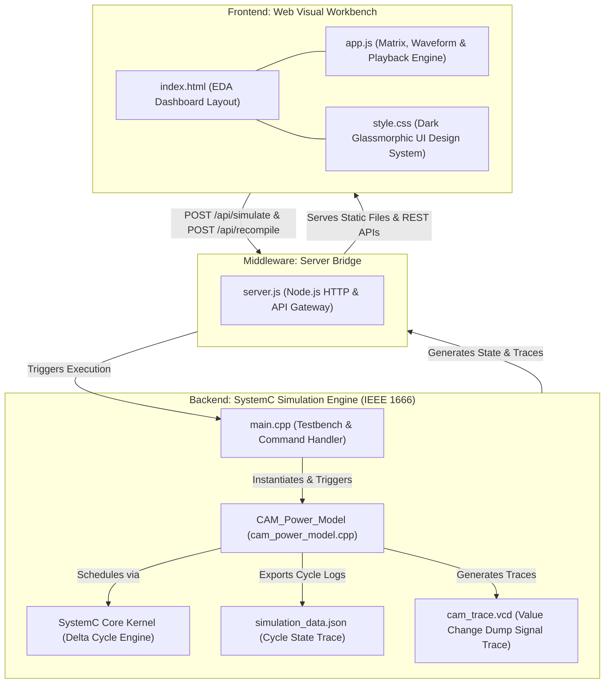

# SystemC Content Addressable Memory (CAM) Power Estimation & Web Visualization Workbench

[](https://chandansaipavanpadala.github.io/sysc-cam-power/)
[](https://chandansaipavanpadala.github.io/sysc-cam-power/)
[](https://systemc.org/)
[](LICENSE)

An Electronic System-Level (ESL) hardware modeling and simulation framework for Content Addressable Memory (CAM) architectures. Built using SystemC (C++ IEEE 1666 standard) and an interactive web visual workbench, this tool provides architectural power estimation, bitwise match-line evaluation, configurable addressing modes (associative, direct, and indirect), SystemC channel instrumentation, VCD waveform tracing, and dynamic web visualization.

> 🚀 **Live Interactive Web EDA Workbench**: Test the full-featured CAM visualizer directly in your browser with zero installation:  
> 👉 **[https://chandansaipavanpadala.github.io/sysc-cam-power/](https://chandansaipavanpadala.github.io/sysc-cam-power/)**

---

## Table of Contents
1. [System Overview & Base Paper Context](#system-overview--base-paper-context)
2. [Application Domains & Edge SoC Utility](#application-domains--edge-soc-utility)
3. [Architecture & Hardware Microarchitecture](#architecture--hardware-microarchitecture)
4. [Part 1: Parameterization Architecture (Eliminating Hardcoded Values)](#part-1-parameterization-architecture-eliminating-hardcoded-values)
5. [Part 2: Configurable Addressing Modes Deep Dive](#part-2-configurable-addressing-modes-deep-dive)
6. [Part 3: SystemC Channel Taxonomy & Delta Cycle Semantics](#part-3-systemc-channel-taxonomy--delta-cycle-semantics)
7. [Mathematical Power & Energy Model](#mathematical-power--energy-model)
8. [Repository Directory Structure](#repository-directory-structure)
9. [Part 4: Simulation Verification & Test Scenarios](#part-4-simulation-verification--test-scenarios)
10. [Visual Demonstration & Experimental Analysis](#visual-demonstration--experimental-analysis)
11. [Waveform Tracing & Logic Analysis](#waveform-tracing--logic-analysis)
12. [Build, Compilation, and Execution](#build-compilation-and-execution)
13. [Continuous Integration & Automated Deployment](#continuous-integration--automated-deployment)
14. [Academic References](#academic-references)

---

## System Overview & Base Paper Context

In modern System-on-Chip (SoC) design, power dissipation is a primary design constraint alongside operational frequency and silicon die area. Traditional Register-Transfer Level (RTL) power analysis in Verilog or VHDL occurs late in the design flow after synthesis and place-and-route, making architectural modifications costly and slow.

This framework is inspired by and advances the methodologies established in the foundation paper:
> **Base Paper:** I-Jui Tung, Che-Wei Chou, and Jing-Ying Chen, *"A SystemC Content Addressable Memory Power Estimation Tool for Early Design Verification"*, **IEEE International Conference on Systems, Man, and Cybernetics (SMC)**, 2010.

By implementing an ESL cycle-accurate power estimation engine in IEEE 1666 SystemC, hardware architects can:
1. Eliminate hardcoded hardware dimensions through dynamic C++ template metaprogramming (`CAM_DEPTH`, `CAM_WIDTH`).
2. Explore multiple addressing modes: Content/Associative addressing for single-cycle queries, alongside Direct and Indirect (Base + Offset) addressing for memory writes.
3. Explicitly instrument and observe SystemC primitive communication channels (`sc_prim_channel`) and evaluate-update delta cycle semantics.
4. Estimate dynamic match-line switching dissipation and leakage floors long before committing to RTL synthesis.
5. Inspect hardware memory states, bitwise XOR comparisons, and digital waveforms in an Electronic Design Automation (EDA) web workbench.

---

## Application Domains & Edge SoC Utility

Content Addressable Memory (CAM) provides single-cycle parallel $O(1)$ search capability by interrogating all memory entries simultaneously. This architecture is vital across multiple SoC edge domains:

### 1. Smart Construction Site Safety & Structural Health Monitoring (SHM) IoT Networks
In smart construction site monitoring, wireless IoT sensor nodes equipped with multi-axis accelerometers, strain gauges, temperature sensors, and tilt meters continuously evaluate structural integrity and worker safety metrics. 

CAM modules operating on edge hardware act as ultra-low-latency anomaly detectors. Sensor measurement vectors are matched in parallel against pre-programmed structural hazard thresholds. Modeling match-line dynamic power dissipation in SystemC enables hardware designers to optimize power budgets and maximize battery operating lifetimes for wireless sensor nodes deployed on construction sites.

### 2. High-Speed Network IP Routing & Packet Header Processing
In enterprise router hardware, CAM modules process incoming packet headers, comparing destination IP addresses (32-bit IPv4 or 128-bit IPv6) against routing tables in a single clock cycle. SystemC power estimation models dynamic match-line capacitive discharge during high-throughput packet classification.

---

## Architecture & Hardware Microarchitecture

### System-Level Integration Architecture

The framework consists of a native C++ SystemC simulation engine (`Backend/`) coupled via a lightweight server bridge (`server.js`) to an Electronic Design Automation (EDA) web visual workbench (`Frontend/`).



### CAM Hardware Microarchitecture Block Diagram

```text
                               +-------------------------------------------------------------+
                               |                    Clock & Control Unit                     |
                               | (clk, enable, write_en, addr_mode_indirect, base_ptr_reg)   |
                               +-----------------------------+-------------------------------+
                                                             |
                 +-------------------------------------------+-------------------------------+
                 |                                                                           |
                 v (Associative Search Path)                                                 v (Write Path: Direct vs Indirect)
+------------------------------------+                                      +------------------------------------+
|        Query Word Register         |                                      |       Effective Address Unit       |
|          (search_pattern)          |                                      |   Direct: EA = write_addr          |
+-----------------+------------------+                                      |   Indirect: EA = Base + write_addr |
                  |                                                         +-----------------+------------------+
                  |                                                                           |
                  |     +---------------------------------------------------------------------+
                  |     |
                  v     v
+-----------------------------------------------------------------------+
|                     CAM Memory Storage Array                          |
|                     (CAM_DEPTH x CAM_WIDTH)                           |
|       Entry 0  : [ Cell 0,0  ] [ Cell 0,1  ] ... [ Cell 0,W-1  ]       |
|       Entry 1  : [ Cell 1,0  ] [ Cell 1,1  ] ... [ Cell 1,W-1  ]       |
|       ...                                                             |
|       Entry D-1: [ Cell D-1,0] [ Cell D-1,1] ... [ Cell D-1,W-1]       |
+-----------------------------------------------------------------------+
                  |
                  v
+-----------------------------------------------------------------------+
|                 Parallel Bitwise XOR Comparator Matrix                |
|       Row 0: Entry[0]   ^ Pattern  ---> Line 0 Mismatches & Match-0   |
|       Row 1: Entry[1]   ^ Pattern  ---> Line 1 Mismatches & Match-1   |
|       ...                                                             |
|       Row D-1: Entry[D-1] ^ Pattern ---> Line D-1 Mismatches & Match-D |
+-----------------------------------------------------------------------+
                  |                                          |
                  v                                          v
+------------------------------------+      +------------------------------------+
|       Priority Encoder Unit        |      |    Match-Line Dynamic & Static     |
|   (Resolves Lowest Match Index)    |      |      Power Calculation Engine      |
+-----------------+------------------+      +-----------------+------------------+
                  |                                           |
                  v                                           v
+------------------------------------+      +------------------------------------+
| Outputs: match_found, match_addr   |      | Outputs: estimated_power_mw,       |
|                                    |      |          accumulated_energy_mj     |
+------------------------------------+      +------------------------------------+
```

---

## Part 1: Parameterization Architecture (Eliminating Hardcoded Values)

Prior implementations hardcoded array dimensions (`#define CAM_DEPTH 10`, `#define CAM_WIDTH 16`), static power figures, and memory contents using inline literals. This refactoring completely eliminates hardcoding by introducing C++ template metaprogramming and dynamic constructor parameters.

### 1. C++ Template Parameterization (`Backend/cam_power_model.h`)

The `CAM_Power_Model` class is parameterized over memory depth and word width:

```cpp
template <unsigned int CAM_DEPTH = 10, unsigned int CAM_WIDTH = 16>
class CAM_Power_Model : public sc_module {
public:
    // Scalable data bus type: sc_uint for width <= 64, sc_biguint for arbitrary width (e.g. 128-bit IPv6)
    using data_t = typename std::conditional<(CAM_WIDTH > 64), 
                                             sc_biguint<CAM_WIDTH>, 
                                             sc_uint<CAM_WIDTH>>::type;
    ...
};
```

#### Dynamic Data Width Selection (`data_t`)
In SystemC, `sc_uint<W>` is limited to $W \le 64$ bits. By employing `std::conditional`, widths greater than 64 (such as 128-bit IPv6 addresses) seamlessly switch to `sc_biguint<W>` without compiler truncation warnings or shift overflows.

### 2. Dynamic Constructor Parameters

Empirical power coefficients and base registers are passed dynamically into the module constructor:

```cpp
CAM_Power_Model(sc_module_name name, 
                double p_leak = 0.002, 
                double e_factor = 0.015, 
                sc_uint<32> init_base_ptr = 0);
```

Stored internally as member variables:
* `p_leakage` (Static floor, default: $0.002 \text{ mW}$)
* `e_mismatch_factor` (Dynamic coefficient, default: $0.015 \text{ mW/mismatched bit}$)
* `base_pointer_reg` (Base address register for indirect writes)

### 3. Dynamic Memory Initialization (`load_initial_memory`)

Hardcoded initialization loops (`cam_array[i] = 0xA5A5 + i;`) are removed. Memory is initialized at runtime via a dedicated member function:

```cpp
void load_initial_memory(const std::vector<data_t>& init_data);
```

In `main.cpp`, initial contents are passed dynamically:
```cpp
std::vector<sc_uint<16>> initial_contents = {
    0xA5A5, 0xA5A6, 0xA5A7, 0xA5A8, 0xA5A9,
    0xA5AA, 0xA5AB, 0xA5AC, 0xA5AD, 0xA5AE
};
cam.load_initial_memory(initial_contents);
```

---

## Part 2: Configurable Addressing Modes Deep Dive

The hardware model supports multiple addressing paradigms for read (search) and write operations.

### 1. Associative / Content Addressing Mode (Search Operations)

Content Addressable Memory operates inversely to standard RAM. Instead of providing an address to retrieve data, the user provides a data word (`search_pattern`), and the CAM resolves the physical address where that data is stored in **1 single clock cycle** ($O(1)$ time complexity).

* **Mechanism:** The `search_pattern` is broadcast across all entries simultaneously.
* **Evaluation:** Each entry performs a parallel bitwise XOR:
  $$\text{MismatchMap}_i = \text{CamArray}[i] \oplus \text{SearchPattern}$$
* **Hit Resolution:** If $\text{MismatchMap}_i = 0$, entry $i$ signals a match. The priority encoder returns the lowest matching index via `match_addr`.

### 2. Switchable Direct vs. Indirect Addressing Modes (Write Operations)

Writing into CAM requires specifying an explicit row index. The model introduces hardware control to switch between **Direct Addressing** and **Indirect (Base + Offset) Addressing**:

```cpp
enum AddressingMode { 
    DIRECT_ADDRESSING   = 0, 
    INDIRECT_ADDRESSING = 1 
};
```

Control is governed by the input port:
```cpp
sc_in<bool> addr_mode_indirect; // 0 = Direct, 1 = Indirect
```

#### Mode A: Direct Addressing (`addr_mode_indirect = 0`)
The index supplied on `write_addr` directly specifies the target physical row:
$$EA = \text{Address}$$

#### Mode B: Indirect / Base-Offset Addressing (`addr_mode_indirect = 1`)
The effective address is computed by adding the internal base pointer register to the offset provided on `write_addr`:
$$EA = \text{Base} + \text{Offset}$$

```text
                         +-----------------------+
                         |   base_pointer_reg    | (e.g., 2)
                         +-----------+-----------+
                                     |
                                     v
+-----------------------+         +-----+
|   write_addr (Offset) |-------->| Adder|------> Effective Address (EA = 2 + 3 = 5)
+-----------------------+         +-----+             |
                                                      v
                                        +---------------------------+
                                        |  Bounds Check (EA < DEPTH)|
                                        +-------------+-------------+
                                                      |
                                                      v
                                        +---------------------------+
                                        | cam_array[EA] = write_data|
                                        +---------------------------+
```

#### Memory Bounds Checking
Before committing any write operation, hardware bounds checking guarantees memory integrity:
```cpp
if (effective_addr < CAM_DEPTH) {
    cam_array[effective_addr] = write_data.read();
} else {
    std::cout << "[ERROR] Address Out of Bounds! Effective: " 
              << effective_addr << " >= Depth: " << CAM_DEPTH << std::endl;
}
```

### Addressing Mode Comparison

| Addressing Mode | Operational Context | Address Source | Effective Address Formula | Cycle Latency |
| :--- | :--- | :--- | :--- | :--- |
| **Associative (Content)** | Search / Lookup | Broadcast `search_pattern` | Resolved via Priority Encoder | 1 Clock Cycle ($O(1)$) |
| **Direct Addressing** | Memory Write | Input port `write_addr` | $EA = \text{Address}$ | 1 Clock Cycle |
| **Indirect (Base+Offset)**| Relocatable Write | `base_pointer_reg` + `write_addr` | $EA = \text{Base} + \text{Offset}$ | 1 Clock Cycle |

---

## Part 3: SystemC Channel Taxonomy & Delta Cycle Semantics

### SystemC Channel Taxonomy Table

SystemC communication revolves around **channels** that implement interfaces (`sc_interface`). Channels are divided into:
1. **Primitive Channels (`sc_prim_channel`):** Do not contain hierarchical processes; participate directly in the SystemC kernel's evaluate-update delta cycle.
2. **Hierarchical Channels (`sc_channel`):** Modules containing internal processes, ports, or sub-channels (e.g., FIFO modules, bus crossbars).

The testbench (`main.cpp`) explicitly instruments **10 Primitive Channels** connecting the testbench to the `CAM_Power_Model` instance:

| # | Channel Name | C++ SystemC Type | Bit Width | Direction | Role & Description | Channel Taxonomy |
| :-: | :--- | :--- | :-: | :-: | :--- | :--- |
| **1** | `clk` | `sc_clock` | 1-bit | TB $\to$ CAM | Hardware master clock generator (100 MHz, 10 ns period, 50% duty cycle) | Primitive Channel |
| **2** | `enable` | `sc_signal<bool>` | 1-bit | TB $\to$ CAM | Global module enable / clock-gating control (low = 0 mW dynamic power) | Primitive Channel |
| **3** | `write_en` | `sc_signal<bool>` | 1-bit | TB $\to$ CAM | Synchronous memory write strobe (high = write cycle, low = search cycle) | Primitive Channel |
| **4** | `addr_mode_indirect` | `sc_signal<bool>` | 1-bit | TB $\to$ CAM | Addressing mode selector: `0` = Direct, `1` = Indirect (Base + Offset) | Primitive Channel |
| **5** | `write_addr` | `sc_signal<sc_uint<32>>` | 32-bit | TB $\to$ CAM | Memory write index register or offset register | Primitive Channel |
| **6** | `match_addr` | `sc_signal<sc_uint<32>>` | 32-bit | CAM $\to$ TB | Priority-encoded address output representing first matching row index | Primitive Channel |
| **7** | `search_pattern` | `sc_signal<data_t>` | 16-bit | TB $\to$ CAM | Query broadcast bus for parallel associative comparison | Primitive Channel |
| **8** | `write_data` | `sc_signal<data_t>` | 16-bit | TB $\to$ CAM | Data bus carrying the word to be written into the CAM array | Primitive Channel |
| **9** | `match_found` | `sc_signal<bool>` | 1-bit | CAM $\to$ TB | Active-high status flag indicating at least one row matched the query | Primitive Channel |
| **10**| `estimated_power_mw` | `sc_signal<double>` | 64-bit | CAM $\to$ TB | Architectural power dissipation output in milliwatts ($P_{\text{total}}$) | Primitive Channel |

All 10 channels inherit from `sc_prim_channel` and utilize the `sc_signal_inout_if<T>` interface.

---

### SystemC Delta Cycle ($\delta$-Cycle) & Evaluate-Update Mechanics

The simulation kernel implements discrete-event simulation via **delta cycles** ($\delta$). A delta cycle models infinitesimal simulation progress ($\Delta t = 0$) where concurrent hardware processes evaluate without advancing simulated physical time.

```text
                  +-----------------------------------------------+
                  |             Evaluate Phase                    |
                  |  - All runnable SC_METHOD / SC_THREAD execute |
                  |  - Processes read CURRENT values (m_cur_val)  |
                  |  - Signal writes call request_update()        |
                  |  - Staging buffers hold NEW values (m_new_val)|
                  +-----------------------+-----------------------+
                                          |
                                          v
                  +-----------------------------------------------+
                  |               Update Phase                    |
                  |  - Kernel invokes channel update() methods    |
                  |  - m_cur_val = m_new_val                      |
                  |  - Value changes trigger process sensitivity  |
                  +-----------------------+-----------------------+
                                          |
                         More events in current delta?
                                /                \
                            [YES]                [NO]
                              /                    \
              Next Delta Cycle                     Advance Simulation Time
              (Delta t = 0)                        to next scheduled event
```

#### Why Evaluate-Update Prevents Race Conditions
In physical digital hardware, flip-flops hold their outputs while combinational logic settles. If a SystemC signal updated immediately upon assignment (`sig.write(val)`), execution order between parallel processes would depend on C++ thread scheduling (a non-deterministic race condition).

By splitting updates into:
1. **Evaluate Phase:** Reading `m_cur_val` while buffering written values in `m_new_val` and queuing `request_update()`.
2. **Update Phase:** Copying `m_new_val` to `m_cur_val` only after all active processes yield.

SystemC guarantees cycle-accurate, deterministic hardware behavior identical to synthesized RTL.

---

## Mathematical Power & Energy Model

### 1. Parallel Match-Line Bitwise XOR Evaluation
In a binary Content Addressable Memory, each entry compares all bits simultaneously against the query `search_pattern` using bitwise XOR logic:

$$\text{MismatchMap}_i = \text{CamArray}[i] \oplus \text{SearchPattern}$$

For each bit position $b \in \{0, \dots, \text{WIDTH}-1\}$, the total bit mismatches for line $i$ is calculated as:

$$\text{LineMismatches}_i = \sum_{b=0}^{\text{WIDTH}-1} \text{MismatchMap}_i[b]$$

If $\text{LineMismatches}_i = 0$, entry $i$ is designated a **MATCH (HIT)**.

### 2. Match-Line Dynamic Power Formula
In physical CMOS CAM circuits, match-lines are pre-charged to $V_{DD}$ prior to evaluation. Any mismatched bit turns on a discharge transistor, discharging the match-line capacitance to ground and consuming dynamic energy.

The power model computes instantaneous match-line power per cycle according to:

$$P_{\text{total}} = P_{\text{leakage}} + \left( \sum_{i=0}^{\text{DEPTH}-1} \text{LineMismatches}_i \right) \times E_{\text{mismatch-factor}}$$

Where empirical model coefficients are dynamically injected:
* Static Base Leakage Floor ($P_{\text{leakage}}$): $0.002 \text{ mW}$ ($2 \ \mu\text{W}$)
* Dynamic Mismatch Energy Coefficient ($E_{\text{mismatch-factor}}$): $0.015 \text{ mW per mismatched bit}$

### 3. Accumulated Energy Formula
Total accumulated energy across $N$ simulation cycles is given by:

$$E_{\text{accumulated}} = \sum_{k=1}^{N} \left( P_{\text{total}}[k] \times T_{\text{clk}} \right)$$

where $T_{\text{clk}} = 10 \text{ ns}$ ($100 \text{ MHz}$ clock frequency).

---

## Repository Directory Structure

```text
sysc-cam-power/
├── .github/
│   └── workflows/
│       └── deploy.yml            # Automated GitHub Actions CI/CD Pages Deployment
├── Backend/
│   ├── cam_power_model.h         # Parameterized C++ Template Header & Port Declarations
│   ├── cam_power_model.cpp       # Bitwise XOR Match Logic & JSON Exporter Implementation
│   ├── main.cpp                  # 10-Channel Instrumented Testbench & 5 Scenarios
│   ├── run_sim.bat               # Windows Batch Simulation Launcher
│   ├── Makefile                  # GCC/g++ MinGW Automated Build File
│   ├── CMakeLists.txt            # CMake Cross-Platform Build Configuration
│   ├── sim.exe                   # Compiled SystemC 3.0.2 Binary Executable
│   ├── cam_trace.vcd             # Value Change Dump Waveform Signal Trace
│   └── simulation_data.json      # Structured Multi-Cycle State Telemetry
│
├── Frontend/
│   ├── index.html                # Visual Workbench Dashboard HTML Structure
│   ├── style.css                 # Dark Glassmorphic Design System & Micro-animations
│   ├── app.js                    # UI Controller, Hardware Matrix & Playback Engine
│   ├── server.js                 # Node.js HTTP Server & SystemC Execution Gateway
│   └── simulation_data.json      # Bundled Dataset for Static & GitHub Pages Hosting
│
├── Screenshots/
│   ├── backend.png               # SystemC C++ Simulation Execution Terminal Capture
│   └── frontend.png              # EDA Web Visual Workbench Dashboard Interface Capture
│
├── run_web.bat                   # Top-Level One-Click Launch Script (Keeps Log Open)
├── LICENSE                       # Project License File
└── README.md                     # Technical System Documentation
```

---

## Part 4: Simulation Verification & Test Scenarios

The testbench (`main.cpp`) exercises five verification scenarios designed to validate associative search, power scaling, direct writes, and indirect writes:

| Test Case | Addressing Mode | Operation | Pattern / Input | Target / Effective Address | Mismatches | Result | Instant Power |
| :--- | :--- | :--- | :--- | :--- | :-: | :-: | :-: |
| **TC1** | **Associative** | Search | `0xA5A5` | Resolves to Index 0 | 21 bits | **HIT** | 0.317 mW |
| **TC2** | **Associative** | Search | `0x5A5A` | No match across array | 139 bits | **PEAK MISS** | 2.087 mW |
| **TC3** | **Direct Write** | Write | `0x1234` | $EA = \text{Address}(3) = 3$ | N/A | **WRITE** | 0.002 mW |
| **TC4** | **Indirect Write**| Write | `0xDEAD` | $EA = \text{Base}(2) + \text{Offset}(3) = 5$ | N/A | **WRITE** | 0.002 mW |
| **TC5** | **Associative** | Search | `0xDEAD` | Resolves to Index 5 | 68 bits | **HIT** | 1.022 mW |

### SystemC Simulation Terminal Output Trace

```text
        SystemC 3.0.2-Accellera --- Aug  1 2026 08:17:32
        Copyright (c) 1996-2025 by all Contributors,
        ALL RIGHTS RESERVED
[CAM INIT] Dynamically loaded 10 entries into CAM array (10x16)

Info: (I703) tracing timescale unit set: 1 ns (cam_trace.vcd)

====================================================================
     SYSTEMC ESL CAM POWER & ADDRESSING VERIFICATION TESTBENCH      
====================================================================
  Configuration      : 10 Entries x 16 Bits
  Base Pointer Reg   : 2 (Indirect Addressing Base)
  Static Leakage     : 0.002 mW
  Dynamic Coefficient: 0.015 mW/mismatch-bit
  Clock Frequency    : 100 MHz (Period: 10 ns)
  SystemC Channels   : 10 Primitive Channels (sc_prim_channel)
  Kernel Execution   : Evaluate-Update delta cycle phases enabled
====================================================================

--- TEST CASE 1: Associative Search for Pattern 0xA5A5 (Expected HIT at Index 0) ---
    [Delta Cycle] Staging search_pattern=0xA5A5 -> evaluate phase -> update phase
[CAM SEARCH] @0 s | Mode: ASSOCIATIVE (Content) | Pattern: 0x0a5a5 | Result: HIT  | Addr: 0 | Bit Mismatches: 21 | Power: 0.317 mW

--- TEST CASE 2: Associative Search for Inverted Pattern 0x5A5A (Expected Peak MISS) ---
    [Delta Cycle] Staging search_pattern=0x5A5A -> evaluate phase -> update phase
[CAM SEARCH] @10 ns | Mode: ASSOCIATIVE (Content) | Pattern: 0x05a5a | Result: MISS | Addr: -1 | Bit Mismatches: 139 | Power: 2.087 mW

--- TEST CASE 3: Direct Addressing Write (addr_mode_indirect=0, Write 0x1234 to Index 3) ---
    [Addressing Math] Effective Address = write_addr = 3
[CAM WRITE] @20 ns | Mode: DIRECT | Base: N/A | Offset: 3 | EffAddr: 3 | Data: 0x01234

--- TEST CASE 4: Indirect Addressing Write (addr_mode_indirect=1, Base=2, Offset=3 -> Index 5) ---
    [Addressing Math] Effective Address = Base(2) + Offset(3) = 5
[CAM WRITE] @30 ns | Mode: INDIRECT (Base+Offset) | Base: 2 | Offset: 3 | EffAddr: 5 | Data: 0x0dead

--- TEST CASE 5: Associative Search for 0xDEAD (Verifying Indirect Write HIT at Index 5) ---
[CAM SEARCH] @40 ns | Mode: ASSOCIATIVE (Content) | Pattern: 0x0dead | Result: HIT  | Addr: 5 | Bit Mismatches: 68 | Power: 1.022 mW

========================================================
         ESL SYSTEMC CAM POWER ESTIMATION REPORT         
========================================================
  CAM Depth             : 10 entries
  CAM Bit Width         : 16 bits
  Base Leakage (P_leak) : 0.002 mW
  Mismatch Factor (E_m) : 0.015 mW/bit
  Base Pointer Register : 2
  Total Search Cycles   : 3
  Total Hits            : 2
  Total Misses          : 1
  Hit Rate              : 66.6667 %
  Accumulated Energy    : 3.426e-05 mJ
========================================================

[JSON EXPORT] Simulation trace data saved to 'simulation_data.json'
[VCD TRACE] Waveform dump saved successfully to 'cam_trace.vcd'

--- Simulation Finished Successfully ---
```

---

## Visual Demonstration & Experimental Analysis

### Figure 1: SystemC C++ Simulation Engine Execution Trace


#### Architectural Analysis of Backend Terminal Output
Figure 1 captures the standalone console execution of the compiled native SystemC IEEE 1666 binary executable (`sim.exe`). The trace validates functional timing, channel updates, addressing calculations, and power modeling:
1. **Dynamic Initialization & VCD Registration:** The simulation kernel allocates a $1 \text{ ns}$ VCD tracing resolution and dynamically loads the 10-entry memory vector without hardcoded values.
2. **Associative Single-Cycle Matching (TC1):** At $t = 0 \text{ s}$, broadcast query `0xA5A5` resolves to physical Row 0 with 21 bit mismatches across unselected rows ($P = 0.317 \text{ mW}$).
3. **Worst-Case Capacitive Discharge (TC2):** At $t = 10 \text{ ns}$, query `0x5A5A` produces 139 bit mismatches across all rows, demonstrating peak dynamic power of $2.087 \text{ mW}$.
4. **Addressing Mode Verification (TC3 & TC4):**
   * TC3 demonstrates **Direct Addressing** ($EA = 3$), writing `0x1234` into Row 3.
   * TC4 demonstrates **Indirect Addressing** ($EA = \text{Base}(2) + \text{Offset}(3) = 5$), writing `0xDEAD` into Row 5. Both write operations exhibit base leakage floor consumption ($0.002 \text{ mW}$).
5. **Content Verification (TC5):** Re-searching `0xDEAD` at $t = 40 \text{ ns}$ triggers an associative **HIT at Row 5**, confirming the indirect write succeeded.

---

### Figure 2: Electronic Design Automation (EDA) Web Visual Workbench


#### Architectural Analysis of Frontend Dashboard Interface
Figure 2 showcases the dark-mode EDA visual dashboard operating locally at `http://localhost:3000` or live on [GitHub Pages](https://chandansaipavanpadala.github.io/sysc-cam-power/). The interface synthesizes hardware memory states, power calculations, and execution telemetry into an integrated supervisory display:
1. **Scenario Navigation Toolbar:** Segmented pill selectors allow one-click traversal across test scenarios (TC1 through TC5) with live status badges.
2. **ESL Power & Energy Engine:**
   * Radial SVG gauge displays instantaneous power ($P_{\text{total}}$) alongside cumulative microjoules.
   * Power breakdown bar visualizes static leakage floor (amber) versus dynamic match-line switching (emerald).
3. **10 x 16 CAM Array Matrix:**
   * 160 individual storage cells render bitwise XOR comparisons (emerald for match, crimson for mismatch).
   * Match lines indicate capacitive discharge states (`DISCHARGED` vs `MATCH`).
   * Reflects in-situ writes from TC3 and TC4 directly in the visual matrix.
4. **Live Command Generator & Kernel Trace:** Allows interactive specification of custom search queries or memory writes with live REST triggering of `sim.exe` (locally) or instant client-side execution (on cloud).

---

## Waveform Tracing & Logic Analysis

Signal transitions across all 10 primitive channels are dumped into `Backend/cam_trace.vcd` (Value Change Dump).

### Inspection via GTKWave
1. Launch GTKWave.
2. Open `Backend/cam_trace.vcd` via **File -> Open Trace**.
3. Under the `SystemC -> CAM_Inst` hierarchy, add the signals:
   * `clk`
   * `enable`, `write_en`, `addr_mode_indirect`
   * `write_addr`, `match_addr`
   * `search_pattern`, `write_data`
   * `match_found`, `estimated_power_mw`
4. Zoom to fit (`Ctrl + 0`) to inspect synchronous clock edges, delta cycle settling, and addressing mode transitions.

---

## Build, Compilation, and Execution

### Prerequisites
- **Compiler**: GCC / MinGW g++ with C++17 support.
- **SystemC**: SystemC 2.3.x or 3.0.x installed at `C:/systemc` (or adjust `-I` and `-L` paths).
- **Node.js**: v14+ (for Web Visual Workbench local server).

### Launch Options

#### Option 0: Live Cloud Web Visualizer (Zero Installation Required)
Directly test and explore the CAM Electronic Design Automation (EDA) dashboard hosted on GitHub Pages:
- 🌐 **Live URL**: [https://chandansaipavanpadala.github.io/sysc-cam-power/](https://chandansaipavanpadala.github.io/sysc-cam-power/)
- Supports interactive multi-cycle stepping, automated playback, test case presets (TC1–TC5), custom vector injection, and live Hamming distance calculations directly in the browser.

#### Option 1: One-Click Web Visual Workbench (Local Node.js Bridge)
```cmd
.\run_web.bat
```
*Compiles the SystemC backend, launches the Node.js bridge server, keeps the console log active, and launches the browser at `http://localhost:3000`.*

#### Option 2: Standalone Command-Line Simulation
```cmd
cd Backend
g++ -std=c++17 -DSC_ALLOW_DEPRECATED_IEEE_API -I C:/systemc/include -L C:/systemc/lib main.cpp cam_power_model.cpp -lsystemc -o sim.exe
.\sim.exe --no-pause
```

#### Option 3: Using Makefile
```cmd
cd Backend
make
make run
```

---

## Continuous Integration & Automated Deployment

This repository features an automated CI/CD pipeline powered by GitHub Actions ([`.github/workflows/deploy.yml`](.github/workflows/deploy.yml)):

- **Automated Workflow:** Every `git push` to the `main` branch automatically triggers the build and deployment workflow.
- **Site Packaging:** The workflow bundles the `Frontend/` application alongside the compiled SystemC execution telemetry (`Backend/simulation_data.json`) and waveform traces (`Backend/cam_trace.vcd`).
- **Official Pages Action:** Deploys zero-downtime static builds using GitHub's official `actions/upload-pages-artifact@v3` and `actions/deploy-pages@v4`.
- **Dual-Engine Architecture:**
  - **Local Execution:** When launched locally with `server.js`, custom queries trigger the native MinGW-compiled C++ SystemC binary (`sim.exe`) via REST endpoints.
  - **Cloud Execution:** When accessed via GitHub Pages, the frontend automatically falls back to an internal client-side simulation engine, executing bitwise XOR operations, priority address resolution, and dynamic power estimation entirely within the browser.

---

## Academic References

1. **Base Paper:** I-Jui Tung, Che-Wei Chou, and Jing-Ying Chen, *"A SystemC Content Addressable Memory Power Estimation Tool for Early Design Verification"*, **IEEE International Conference on Systems, Man, and Cybernetics (SMC)**, pp. 2970-2975, 2010.
2. Accellera Systems Initiative, *"SystemC Language Reference Manual (IEEE Std 1666-2011)"*, IEEE Standards Association, New York, 2012.
3. K. Pagiamtzis and A. Sheikholeslami, *"Content-addressable memory (CAM) circuits and architectures: A tutorial and survey"*, **IEEE Journal of Solid-State Circuits**, vol. 41, no. 3, pp. 712-727, March 2006.
4. C. Zukowski and S. Y. Wang, *"Use of simulation tools for early power estimation in digital system-on-chip design"*, **IEEE Transactions on Computer-Aided Design of Integrated Circuits and Systems**, vol. 22, no. 9, pp. 1145-1158, 2003.
