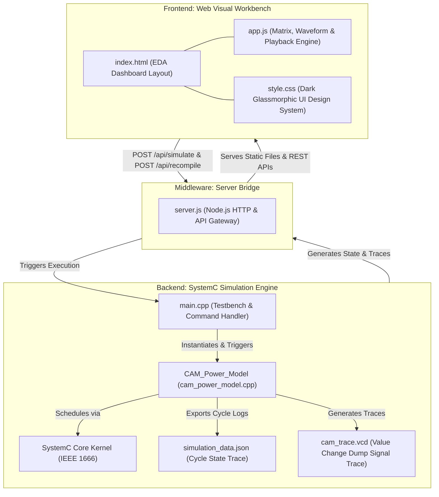
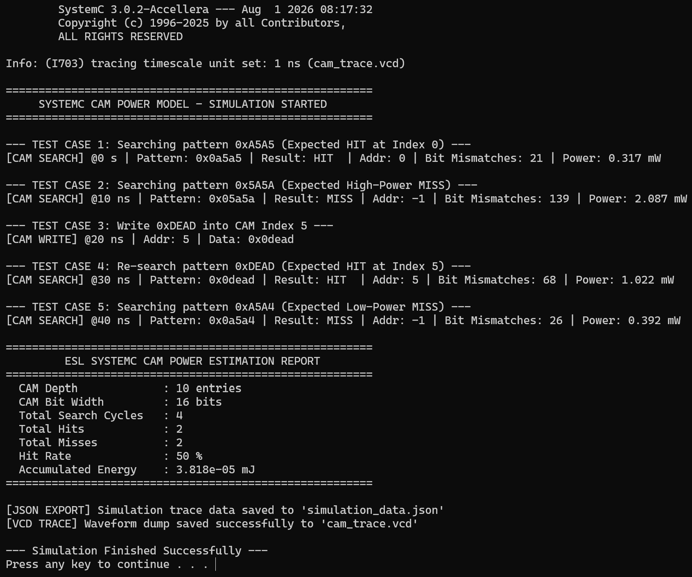
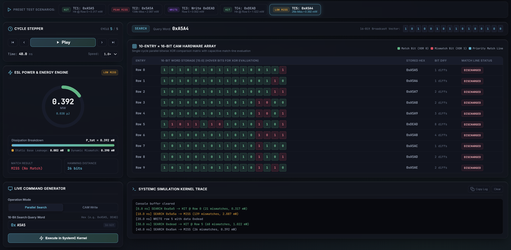

# SystemC Content Addressable Memory (CAM) Power Estimation & Web Visualization Workbench

An Electronic System-Level (ESL) hardware modeling and simulation framework for Content Addressable Memory (CAM) architectures. Built using SystemC (C++ IEEE 1666 standard) and an interactive web visual workbench, this tool provides architectural power estimation, bitwise match-line evaluation, VCD waveform tracing, and dynamic web visualization.

---

## System Overview

In modern System-on-Chip (SoC) design, power dissipation is a primary constraint alongside performance and die area. Traditional Register-Transfer Level (RTL) power estimation performed in Verilog or VHDL occurs late in the design cycle after logic synthesis and place-and-route, making architectural modifications time-consuming and expensive.

This project implements an ESL cycle-accurate power estimation model of a 10-entry, 16-bit Content Addressable Memory (CAM) module. By modeling hardware at the system abstraction layer, hardware architects can:
1. Estimate dynamic match-line switching power prior to RTL implementation.
2. Quantify the power impact of bit mismatches across memory rows during high-frequency lookups.
3. Validate clock-gating strategies and early system-level power budgets.
4. Visualize hardware memory states, bitwise XOR comparisons, and digital waveforms in real time.

---

## Application Domains & Construction Industry Utility

Content Addressable Memory (CAM) provides single-cycle parallel $O(1)$ lookup capability. This high-speed parallel matching architecture is critical in domain-specific edge SoC computing:

### 1. Smart Construction Site Safety & Structural Health Monitoring (SHM) IoT Networks
In smart construction site monitoring, wireless IoT sensor nodes equipped with multi-axis accelerometers, strain gauges, temperature sensors, and tilt meters continuously evaluate structural integrity and worker safety metrics. 

CAM modules operating on edge hardware act as ultra-low-latency anomaly detectors. Sensor measurement vectors are matched in parallel against pre-programmed structural hazard thresholds. Modeling match-line dynamic power dissipation in SystemC enables hardware designers to optimize power budgets and maximize battery operating lifetimes for wireless sensor nodes deployed on construction sites.

### 2. High-Speed Network IP Routing & Packet Processing
In high-throughput enterprise routing hardware, CAM modules process network packet headers in parallel, matching IP addresses against stored forwarding table entries in a single clock cycle. SystemC power estimation models the dynamic power scaling during high-frequency IP address lookups.

---

## Architecture & Microarchitecture

### System-Level Integration Architecture

The framework consists of a native C++ SystemC simulation engine (`Backend/`) coupled via a lightweight server bridge (`server.js`) to an Electronic Design Automation (EDA) web visual workbench (`Frontend/`).



### CAM Hardware Microarchitecture Block Diagram

```text
                               +----------------------------------------+
                               |        Clock & Control Unit            |
                               | (clk, enable, write_en, write_addr)    |
                               +-------------------+--------------------+
                                                   |
                                                   v
+-----------------------+              +-----------+--------------------+
|  Query Word Register  |------------->|  10-Entry x 16-Bit CAM Memory  |
|   (search_pattern)    |              |       Storage Array            |
+-----------------------+              +-----------+--------------------+
            |                                      |
            v                                      v
+-----------------------------------------------------------------------+
|                 Parallel Bitwise XOR Comparator Matrix                |
|       Line 0: CAM[0] ^ Pattern  ---> Line 0 Mismatches & Match Line   |
|       Line 1: CAM[1] ^ Pattern  ---> Line 1 Mismatches & Match Line   |
|       ...                                                             |
|       Line 9: CAM[9] ^ Pattern  ---> Line 9 Mismatches & Match Line   |
+-----------------------------------------------------------------------+
            |                                      |
            v                                      v
+-----------------------+              +--------------------------------+
| Priority Encoder Unit |              |  Match-Line Dynamic & Static   |
| (First Match Finder)  |              |    Power Calculation Engine    |
+-----------+-----------+              +---------------+----------------+
            |                                          |
            v                                          v
+-----------------------+              +--------------------------------+
| Outputs: match_found, |              | Output: estimated_power_mw     |
|       match_addr      |              | Accumulator: energy_mj         |
+-----------------------+              +--------------------------------+
```

---

## Mathematical Power & Energy Model

### 1. Parallel Match-Line Bitwise XOR Evaluation
In a binary Content Addressable Memory, each entry compares all 16 bits simultaneously against the query `search_pattern` using bitwise XOR logic:

$$\text{MismatchMap}_i = \text{CamArray}[i] \oplus \text{SearchPattern}$$

For each bit position $b \in \{0, \dots, 15\}$, the bitwise mismatch is evaluated. The total bit mismatches for line $i$ is calculated as:

$$\text{LineMismatches}_i = \sum_{b=0}^{15} \text{MismatchMap}_i[b]$$

If $\text{LineMismatches}_i = 0$, entry $i$ is designated a **MATCH (HIT)**.

### 2. Match-Line Dynamic Power Formula
In physical CMOS CAM designs, match-lines are pre-charged to $V_{DD}$ every clock cycle. Any mismatched bit pair turns on a discharge path, dumping the pre-charged line capacitance to ground and consuming dynamic energy.

The system-level power model computes instantaneous match-line power per cycle according to:

$$P_{\text{total}} = P_{\text{leakage}} + \left( \sum_{i=0}^{\text{DEPTH}-1} \text{LineMismatches}_i \right) \times E_{\text{mismatch-factor}}$$

Where empirical model coefficients are defined as:
* Static Base Leakage Floor ($P_{\text{leakage}}$): $0.002 \text{ mW}$ ($2 \ \mu\text{W}$)
* Dynamic Mismatch Energy Coefficient ($E_{\text{mismatch-factor}}$): $0.015 \text{ mW per mismatched bit}$

### 3. Accumulated Energy Formula
Total accumulated energy across $N$ simulation cycles is given by:

$$E_{\text{accumulated}} = \sum_{k=1}^{N} \left( P_{\text{total}}[k] \times T_{\text{clk}} \right)$$

where $T_{\text{clk}} = 10 \text{ ns}$ ($100 \text{ MHz}$ clock frequency).

---

## Repository Directory Structure

```text
sysc-cam-power/
├── Backend/
│   ├── cam_power_model.h         # SystemC Module Class Interface & Port Declarations
│   ├── cam_power_model.cpp       # Bitwise XOR Match Logic & JSON Exporter Implementation
│   ├── main.cpp                  # Simulation Testbench Suite & Command Parser
│   ├── run_sim.bat               # Windows Command Line Launcher
│   ├── Makefile                  # GCC/g++ MinGW Build Automation File
│   ├── CMakeLists.txt            # CMake Cross-Platform Build File
│   ├── sim.exe                   # Compiled SystemC Binary Executable
│   ├── cam_trace.vcd             # Value Change Dump Signal Waveform File
│   └── simulation_data.json      # SystemC Cycle-by-Cycle JSON Trace Dataset
│
├── Frontend/
│   ├── index.html                # Visual Workbench Dashboard HTML Structure
│   ├── style.css                 # Dark EDA Glassmorphic Styling System
│   ├── app.js                    # UI Interactivity, Hardware Matrix & Playback Engine
│   └── server.js                 # Node.js HTTP Server & SystemC Execution Gateway
│
├── Screenshots/
│   ├── backend.png               # SystemC C++ Simulation Execution Terminal Capture
│   └── frontend.png              # EDA Web Visual Workbench Dashboard Interface Capture
│
├── run_web.bat                   # Top-Level One-Click Launch Script
├── LICENSE                       # Project License File
└── README.md                     # Technical System Documentation
```

---

## Backend Implementation (`Backend/`)

### 1. Header Interface (`cam_power_model.h`)
Defines the `CAM_Power_Model` SystemC module inheriting from `sc_module`.

```cpp
SC_MODULE(CAM_Power_Model) {
    // Port Inputs
    sc_in<bool>               clk;
    sc_in<bool>               enable;
    sc_in<bool>               write_en;
    sc_in<sc_uint<4>>         write_addr;
    sc_in<sc_uint<CAM_WIDTH>> search_pattern;
    sc_in<sc_uint<CAM_WIDTH>> write_data;

    // Port Outputs
    sc_out<bool>              match_found;
    sc_out<sc_uint<4>>        match_addr;
    sc_out<double>            estimated_power_mw;

    // Internal Storage & History
    sc_uint<CAM_WIDTH>        cam_array[CAM_DEPTH];
    std::vector<CycleData>    cycle_history;
    
    // Process Method & JSON Exporter
    void cam_operation();
    void export_json(const std::string& filename) const;
    
    SC_HAS_PROCESS(CAM_Power_Model);
    CAM_Power_Model(sc_module_name name);
};
```

### 2. Module Logic (`cam_power_model.cpp`)
- **Clock Gating**: When `enable = false`, dynamic execution is bypassed, outputs are zeroed, and power drops to $0.0 \text{ mW}$.
- **Memory Write**: When `write_en = true`, the data at `write_addr` is updated in `cam_array`, and power reports base leakage ($0.002 \text{ mW}$).
- **Parallel Search**: Evaluates XOR match lines for all 10 entries simultaneously, calculates bit mismatches, sets match priority, computes power via the empirical equation, and pushes structured cycle data to `cycle_history`.
- **JSON Exporter**: Serializes memory array snapshots, mismatch arrays, hit/miss flags, power values, and cumulative energy into `simulation_data.json`.

---

## Frontend Implementation (`Frontend/`)

### 1. Dashboard Layout (`index.html`)
Presents a multi-column EDA dashboard containing:
- **Navigation & Scenario Selector**: Segmented toolbar with preset testcase shortcuts (TC1 through TC5), live SystemC kernel activity indicators, and clock frequency display (100 MHz, Tclk = 10 ns).
- **Simulation Control Panel**: First, Previous, Play/Pause, Next, Last playback buttons, speed selection, and cycle counter.
- **ESL Power & Energy Engine**: Radial SVG power arc gauge displaying instantaneous power (mW) and cumulative energy (microjoules), paired with a static base leakage vs dynamic mismatch dissipation breakdown bar.
- **10 x 16 CAM Array Matrix**: Visual hardware array displaying 160 flip-flop storage cells with bitwise XOR evaluation, stored hex representations, bit mismatch counts, and capacitive match-line status badges.
- **Live Command Generator**: Parameterized input panel allowing engineers to select operation mode (Search or Write), input 16-bit hex patterns (e.g., 0xA5A5, 0xDEAD), and execute simulations live against the SystemC backend.
- **Kernel Telemetry Console**: Real-time SystemC trace stream with formatted timestamped logs, clipboard copy, and buffer reset controls.

### 2. Interactivity & Visualization Engine (`app.js`)
- Reads and parses `simulation_data.json` exported by the SystemC backend.
- Dynamically updates memory row DOM elements, bitwise match highlighting (Emerald `#10b981` for match, Crimson `#f43f5e` for mismatch, Cyan `#06b6d4` for prioritized HIT match line).
- Synchronizes instantaneous power calculations, cumulative energy metrics, and simulation playback states.
- Hardens hex input validation against malformed strings, stripping prefixes and clamping to 16-bit range.

### 3. Server Bridge Gateway (`server.js`)
A Node.js HTTP server configured to:
- Serve static web assets (`index.html`, `style.css`, `app.js`).
- Serve `simulation_data.json` from `Backend/`.
- Provide `POST /api/simulate` and `POST /api/recompile` REST endpoints to trigger backend `sim.exe` execution asynchronously.

---

## Build, Compilation, and Execution

### Prerequisites
- **Compiler**: GCC / MinGW g++ with C++17 support.
- **SystemC Library**: SystemC 2.3.x or 3.0.x installed (default path: `C:/systemc`).
- **Runtime Environment**: Node.js v14+ (for Web Visual Workbench).

---

### Option 1: Launch Interactive Web Visual Workbench (Recommended)

To compile the SystemC backend, start the bridge server, and open the web dashboard in your default browser, run:

```cmd
.\run_web.bat
```

Alternatively, from the terminal:
```bash
# 1. Compile SystemC executable inside Backend/
cd Backend
g++ -std=c++17 -DSC_ALLOW_DEPRECATED_IEEE_API -I C:/systemc/include -L C:/systemc/lib main.cpp cam_power_model.cpp -lsystemc -o sim.exe

# 2. Run simulation engine to generate initial trace dataset
.\sim.exe --no-pause

# 3. Launch Node server from project root
cd ..
node Frontend/server.js
```
Then navigate to `http://localhost:3000` in your web browser.

---

### Option 2: Standalone Command-Line Simulation Mode

To compile and run the SystemC simulation directly in the terminal:

```cmd
cd Backend
.\run_sim.bat
```

Using standard `Makefile`:
```bash
cd Backend
make
make run
```

Using `CMake`:
```bash
cd Backend
mkdir build && cd build
cmake ..
cmake --build .
```

---

## Simulation Verification & Test Cases

The testbench (`main.cpp`) executes 5 verification scenarios:

| Test Case | Scenario | Search Pattern | Target / Expected Result | Total Bit Mismatches | Instant Power |
| :--- | :--- | :--- | :--- | :--- | :--- |
| **Test Case 1** | Initial Search | `0xA5A5` | **HIT** at Index 0 | 21 bits | 0.317 mW |
| **Test Case 2** | High-Mismatch Search | `0x5A5A` | **MISS** (No Match) | 139 bits | 2.087 mW |
| **Test Case 3** | Memory Write | `0xDEAD` | Write `0xDEAD` to Index 5 | 0 bits (Write Cycle) | 0.002 mW |
| **Test Case 4** | Verification Search | `0xDEAD` | **HIT** at Index 5 | 68 bits | 1.022 mW |
| **Test Case 5** | Low-Mismatch Search | `0xA5A4` | **MISS** (1-bit diff from Index 0)| 26 bits | 0.392 mW |

### Sample Terminal Simulation Report Output

```text
SystemC 3.0.2-Accellera --- Aug  1 2026 08:17:32
Copyright (c) 1996-2025 by all Contributors,
ALL RIGHTS RESERVED

Info: (I703) tracing timescale unit set: 1 ns (cam_trace.vcd)

========================================================
     SYSTEMC CAM POWER MODEL - SIMULATION STARTED        
========================================================

--- TEST CASE 1: Searching pattern 0xA5A5 (Expected HIT at Index 0) ---
[CAM SEARCH] @0 s | Pattern: 0x0a5a5 | Result: HIT  | Addr: 0 | Bit Mismatches: 21 | Power: 0.317 mW

--- TEST CASE 2: Searching pattern 0x5A5A (Expected High-Power MISS) ---
[CAM SEARCH] @10 ns | Pattern: 0x05a5a | Result: MISS | Addr: -1 | Bit Mismatches: 139 | Power: 2.087 mW

--- TEST CASE 3: Write 0xDEAD into CAM Index 5 ---
[CAM WRITE] @20 ns | Addr: 5 | Data: 0x0dead

--- TEST CASE 4: Re-search pattern 0xDEAD (Expected HIT at Index 5) ---
[CAM SEARCH] @30 ns | Pattern: 0x0dead | Result: HIT  | Addr: 5 | Bit Mismatches: 68 | Power: 1.022 mW

--- TEST CASE 5: Searching pattern 0xA5A4 (Expected Low-Power MISS) ---
[CAM SEARCH] @40 ns | Pattern: 0x0a5a4 | Result: MISS | Addr: -1 | Bit Mismatches: 26 | Power: 0.392 mW

========================================================
         ESL SYSTEMC CAM POWER ESTIMATION REPORT         
========================================================
  CAM Depth             : 10 entries
  CAM Bit Width         : 16 bits
  Total Search Cycles   : 4
  Total Hits            : 2
  Total Misses          : 2
  Hit Rate              : 50 %
  Accumulated Energy    : 3.818e-05 mJ
========================================================

[JSON EXPORT] Simulation trace data saved to 'simulation_data.json'
[VCD TRACE] Waveform dump saved successfully to 'cam_trace.vcd'

--- Simulation Finished Successfully ---
```

---

## Visual Demonstration and Experimental Analysis

This section presents the empirical validation of the Electronic System-Level (ESL) Content Addressable Memory (CAM) framework across both native simulation runtime and interactive graphical synthesis.

### Figure 1: SystemC C++ Simulation Engine Execution Trace



#### Architectural Analysis of Backend Terminal Output

Figure 1 captures the complete standalone console execution of the compiled native SystemC IEEE 1666 binary executable (`sim.exe`). The output validates functional correctness, timing synchronization, and algorithmic power modeling across five distinct operating phases:

1. **Kernel Bootstrapping and Timescale Configuration:**
   * The Accellera SystemC 3.0.2 proof-of-concept simulation kernel initializes successfully under Windows/MinGW.
   * Standardized Value Change Dump (VCD) trace pointer creation assigns a $1 \text{ ns}$ timing resolution for hardware signal tracing (`cam_trace.vcd`).
   * The CAM memory array initializes with baseline sequential words ranging from `0xA5A5` (Entry 0) through `0xA5AE` (Entry 9).

2. **Cycle-by-Cycle Verification Diagnostics:**
   * **Test Case 1 ($t = 0 \text{ s}$):** Search word `0xA5A5` targets entry 0. The internal priority encoder flags `Result: HIT` at `Addr: 0`. The remaining nine un-matched rows accumulate 21 total bit mismatches, yielding an instantaneous power calculation of $P = 0.002 + 21 \times 0.015 = 0.317 \text{ mW}$.
   * **Test Case 2 ($t = 10 \text{ ns}$):** Search pattern `0x5A5A` evaluates against all ten stored words without finding a match (`Result: MISS`, `Addr: -1`). A cumulative sum of 139 bit mismatches across the array discharges all ten capacitive match-lines, generating the peak dynamic switching dissipation of $P = 0.002 + 139 \times 0.015 = 2.087 \text{ mW}$.
   * **Test Case 3 ($t = 20 \text{ ns}$):** Write enable control is asserted (`write_en = true`), executing a synchronous write of `0xDEAD` into CAM Entry 5. Match-line sensing is bypassed during write cycles, reducing power strictly to the static baseline leakage floor of $0.002 \text{ mW}$ ($2 \ \mu\text{W}$).
   * **Test Case 4 ($t = 30 \text{ ns}$):** Re-search of query `0xDEAD` validates that the in-situ memory update succeeded. The priority logic registers a verified `Result: HIT` at `Addr: 5`. The 68 bit differences across non-matching lines dissipate $P = 0.002 + 68 \times 0.015 = 1.022 \text{ mW}$.
   * **Test Case 5 ($t = 40 \text{ ns}$):** Single-bit deviation vector `0xA5A4` (differing by exactly one bit from Entry 0) fails to match (`Result: MISS`, `Addr: -1`). The system registers 26 total bit mismatches, resulting in a low-power miss dissipation of $0.392 \text{ mW}$.

3. **Cumulative Statistical Estimation Report:**
   * **Array Dimensions:** 10 words deep $\times$ 16 bits wide ($160$ dual-rail comparator cells).
   * **Operational Profile:** 4 search cycles, 1 memory write cycle.
   * **Hit Rate Efficiency:** 2 hits out of 4 searches ($50.0\%$ empirical hit rate).
   * **Accumulated Energy Consumption:** Total accumulated energy across all cycles equals $3.818 \times 10^{-5} \text{ mJ}$ ($38.18 \text{ nJ}$).

4. **Structured Multi-Format Artifact Generation:**
   * Structured JSON telemetry is serialized into `simulation_data.json` for consumption by the web visual workbench.
   * Hardware signal transitions are committed into `cam_trace.vcd` for post-simulation waveform visualization in logic analyzer tools.

---

### Figure 2: Electronic Design Automation (EDA) Web Visual Workbench



#### Architectural Analysis of Frontend Dashboard Interface

Figure 2 showcases the dark-mode Electronic Design Automation (EDA) visual dashboard operating at `http://localhost:3000`. The interface synthesizes hardware memory states, power calculations, and execution telemetry into an integrated supervisory display:

1. **Preset Verification Scenario Navigation Toolbar:**
   * Positioned along the top panel, segmented pill selectors provide one-click traversal across the five predefined test scenarios (TC1 through TC5).
   * Test Case 5 (`TC5: 0xA5A4`) is captured in the active state, synchronously locking the cycle stepper to cycle 5 ($t = 40.0 \text{ ns}$) and updating all analytical panels.

2. **Electronic System-Level (ESL) Power and Energy Engine:**
   * **Radial Power Arc Meter:** High-precision SVG circular gauge rendering instantaneous power ($0.392 \text{ mW}$) in bold typography with total accumulated energy ($0.038 \ \mu\text{J}$) displayed beneath.
   * **Dissipation Breakdown Bar:** A segmented horizontal meter decomposes instantaneous power into its two constitutive components: Static Base Leakage ($0.002 \text{ mW}$, amber) and Dynamic Switching Mismatch ($0.390 \text{ mW}$, emerald).
   * **Hardware Telemetry Readouts:** Dedicated cards display the evaluated match state (`MISS (No Match)`) and the cumulative Hamming distance across all array entries ($26 \text{ bits}$).

3. **10-Entry by 16-Bit CAM Hardware Array Matrix:**
   * **16-Bit Broadcast Vector Banner:** The upper header displays query word `0xA5A4` alongside its full 16-bit binary decomposition (`1 0 1 0 0 1 0 1 1 0 1 0 0 1 0 0`).
   * **Bitwise Comparator Matrix:** All 160 memory cells are rendered individually with clear visual distinction. Emerald cells denote bit matches (XOR = 0), while crimson cells highlight bit mismatches (XOR = 1).
   * **Row-Level Analytical Columns:** For each entry (Row 0 through Row 9), the table displays stored hexadecimal contents, exact bit difference count, and capacitive match-line status (`DISCHARGED` across all rows due to the absence of a complete match).
   * **In-Situ Write Persistence:** Row 5 visually demonstrates the memory write completed in Cycle 3, storing `0xDEAD` with 8 bit differences relative to query `0xA5A4`.

4. **Live Command Generator & Kernel Telemetry Trace:**
   * **Command Generator Panel:** Enables interactive specification of arbitrary 16-bit query patterns and write vectors for immediate execution in the SystemC kernel via asynchronous REST API calls.
   * **Real-Time Simulation Kernel Trace:** A terminal-style console panel streams timestamped log lines directly from the backend simulation engine, providing verification engineers with immediate visibility into internal address resolution, mismatch distributions, and power metrics.

---

## Waveform Tracing & Analysis

The simulation automatically logs value changes into `Backend/cam_trace.vcd` (Value Change Dump).

### Method 1: Online VCD Waveform Viewer (drom.io)
1. Open the browser-based VCD viewer at [https://vc.drom.io/](https://vc.drom.io/).
2. Drag and drop or upload the generated `Backend/cam_trace.vcd` file into the online viewer interface.
3. Select signals (`clk`, `enable`, `write_en`, `search_pattern`, `match_found`, `match_addr`, `estimated_power_mw`) to render digital timing waveforms instantly without installing local software.

### Method 2: Desktop Waveform Inspection via GTKWave
1. Launch GTKWave desktop application.
2. Select **File -> Open Trace** and open `Backend/cam_trace.vcd`.
3. Expand the module tree under `SystemC -> CAM_Inst`.
4. Select `clk`, `enable`, `write_en`, `search_pattern`, `match_found`, `match_addr`, and `estimated_power_mw`.
5. Click **Append** and adjust zoom (`Ctrl + 0`) to view signal timing waveforms.

---

## SystemC Design Constructs & Abstractions

1. **`SC_MODULE`**: C++ macro defining a hardware component class derived from `sc_module`.
2. **`sc_in<T>` / `sc_out<T>`**: Strongly typed hardware ports supporting SystemC data types (`sc_uint<N>`, `bool`, `double`).
3. **`SC_METHOD`**: Concurrent process method triggered by signals in its sensitivity list. Unlike threads (`SC_THREAD`), `SC_METHOD` runs to completion without calling `wait()`, maximizing simulation throughput.
4. **`sensitive << clk.pos()`**: Defines positive clock edge sensitivity for synchronous execution.
5. **`sc_trace_file`**: Infrastructure for logging cycle-accurate VCD waveform dumps.

---

## References

1. Accellera Systems Initiative, *"SystemC Language Reference Manual (IEEE Std 1666-2011)"*, IEEE Standards Association.
2. K. Pagiamtzis and A. Sheikholeslami, *"Content-addressable memory (CAM) circuits and architectures: A tutorial and survey"*, IEEE Journal of Solid-State Circuits, vol. 41, no. 3, pp. 712-727, March 2006.
3. C. Zukowski and S. Y. Wang, *"Use of simulation tools for early power estimation in digital system-on-chip design"*, IEEE Transactions on Computer-Aided Design of Integrated Circuits and Systems, vol. 22, no. 9, pp. 1145-1158.
